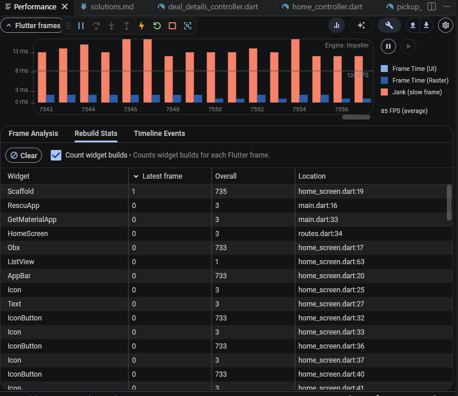
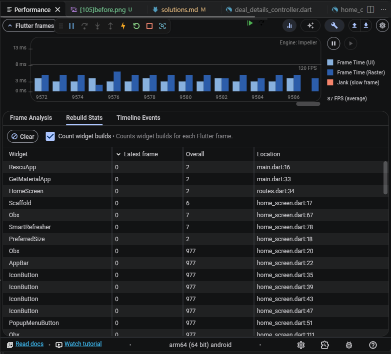
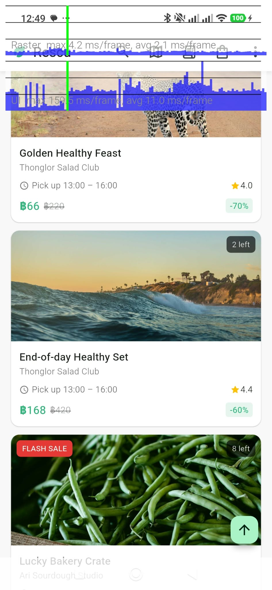
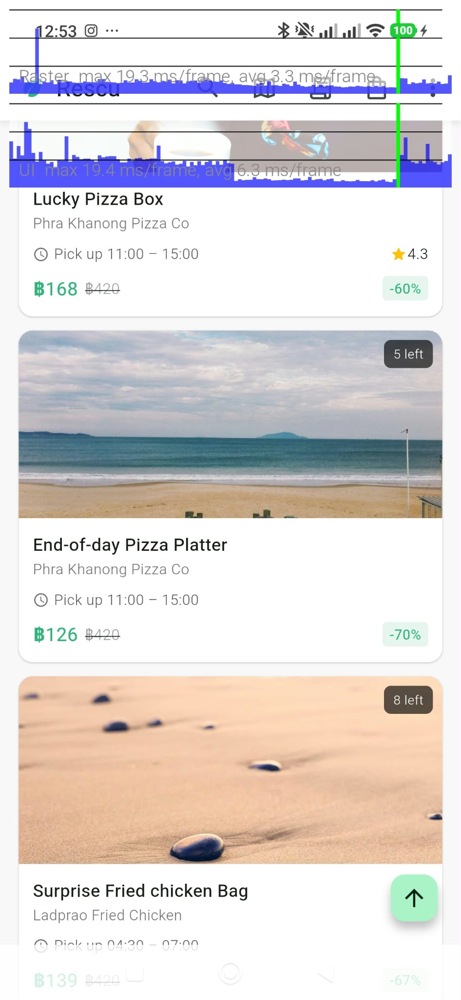
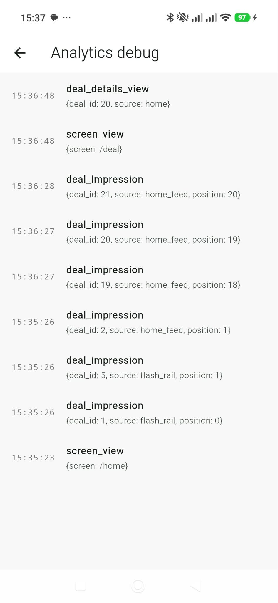

[RES-101] Fix Search Race Condition
Root cause:
The issue occurs because the input field's onChange event triggers an API call to search for data. Since onChange captures every single keystroke from the user, typing rapidly continuous input causes a race condition between API requests. To resolve this, a combined approach was implemented using Debounce (delay mechanism) and a Sequence check to ensure only the latest API request is processed.

Why this solution is effective:
The Debounce technique adds a slight delay to avoid firing frequent API calls to the backend, which reduces unnecessary API usage and minimizes the load on the server and network. Meanwhile, the Sequence check acts as a safeguard in case an API response takes too long to return, preventing outdated requests from overriding newer data.

Alternatives considered and rejected:
Making it so the user has to finish writing or typing before sending a call to the API. This method is not very good because it results in poor UX performance, whereas it should ideally show results as typed, whether it is the first character, second character, or before typing is completed.

Edge cases considered:
Handling the immediate text deletion when the user deletes that text in order to type anew.

[RES-102] Fix My Orders Crash
Root Cause:
The issue occurs because background operations continue running even after the user navigates away from the screen. Since the timer is not stopped upon exiting, it keeps executing in the background and attempts to trigger updates on a destroyed widget, resulting in a setState() called after dispose() error.

Why this solution is effective:
Canceling the timer within the dispose() method ensures that background tasks are properly terminated when the screen is closed. This prevents unnecessary resource usage, stops outdated operations from running, and cleanly resolves the lifecycle-related error.

Alternatives considered and rejected:
Using if (mounted) as part of the condition to solve this issue; however, this only hides the symptom where the error occurs rather than fixing the root cause that triggers dispose().

Edge cases considered:
Pausing the timer in pickup_countdown.dart temporarily in the background and having it resume when the user returns. We determined that even if it were stopped and the user returned later, it wouldn't have any noticeable effect on the user, and it carries a higher risk of destabilizing the system.

[RES-103] Fix send too many request
Root Cause:
The issue was caused by using an undisposed ever listener. Whenever the cart changed, it repeatedly triggered API calls for every deal previously viewed, even after those screens were closed. The controller should be properly disposed of when navigating away from the screen.

Why this solution is effective:
This approach prevents repetitive API calls for closed screens and ensures that only the current, active deal screen fetches the latest stock availability.

Alternatives considered and rejected:
Using debounce to delay the API calls. However, we determined that delaying it wouldn't help, would introduce latency that harms the app's UX responsiveness, and fails to address the root cause originating from the undisposed listener.

Edge cases considered:
Handling background cart synchronization to simultaneously calculate prices, time, or remaining quantities in the background.

[RES-104] Duplicate deals feed
Root Cause:
The issue was caused by an unmanaged asynchronous race condition between pull-to-refresh and infinite scroll pagination. When both operations executed concurrently without state validation, pagination appended incoming items to the dataset while a refresh was resetting it, resulting in duplicate or out-of-order records.

Why this solution is effective:
This approach introduces concurrency state guards to prevent overlapping data mutations, ensuring that the deal list is updated cleanly and sequentially without cross-request data contamination.

Alternatives considered and rejected:
Considering traditional pagination, but rejecting it because an e-commerce home feed should allow smooth scrolling for a great user experience, and changing the core design from infinite scrolling to pagination was outside the scope of this performance fix ticket.

Edge cases considered:
Handling extremely long lists containing thousands of items, which could become bloated and potentially cause a drop in frame rate (FPS).

[RES-105] Home Feed Performance & Memory Optimization

 

Root Cause:
The issue was caused by an overly broad Obx widget wrapping the entire Scaffold. As captured in the initial DevTools Rebuild Stats, scrolling the feed triggered full page rebuilds that pushed the overall rebuild count of Scaffold and SmartRefresher up to nearly four hundred times. Additionally, unmanaged image caching led to continuous heap growth and potential Out Of Memory crashes.

Why this solution is effective:
Wrapping the entire AppBar, ListView, or various buttons with Obx caused widgets to be rebuilt unnecessarily 733 times as shown in the image  , resulting in slow frames, severe jank, and app stuttering. However, by breaking down Obx into smaller, segmented parts, widgets are built only in necessary areas, thereby reducing processing load and ensuring smooth frames.

Alternatives considered and rejected:
Considering traditional pagination, but rejecting it because an e-commerce home feed should allow smooth scrolling for a great user experience, and changing the core design from infinite scrolling to pagination was outside the scope of this performance fix ticket.

Edge cases considered:
Handling extremely long lists containing thousands of items, which could become bloated and potentially cause a drop in frame rate (FPS).

[F-1] Live flash-sale countdowns
Root Cause:
The flash sale feature only had an "ends soon" label without showing the remaining time, making it impossible for users to know how many hours, minutes, or seconds were left, which violates good UX/UI principles. Therefore, flashSaleEndsAt was fetched from the deal model and subtracted from the current time to calculate the remaining time or check if it had expired. A live_countdown_widget was created to serve as the display component for the remaining time and structured as a card for other widgets or cards to reuse. The flash deals placed in the cart were then handled to disappear from the cart when expired by having the controller call service.remove(dealId) to delete that deal ID and display text.

Why this solution is effective:
Each flash sale uses livecountdownwidget independently, causing specific text labels to rebuild separately based on localized timing instead of building everything simultaneously across the entire app or bar, making the app stutter-free and smoother. Handling the removal of expired items from the cart was moved to the Cartcontroller so it acts as the entity checking and managing background items when deleted and triggering notifications. Therefore, addPostFrameCallback was used in check expired to wait for the build to finish before displaying the expiration message.

Alternatives considered and rejected:
Implementing a global timing system that synchronizes identically across the entire app. This was rejected because time differences across regions would cause chaotic global timing, creating unnecessary complexity and inefficiency compared to the independent approach.

Edge cases considered:
Supporting time zone handling even if the user manually changes their device time or switches device time zones back and forth.

[F-2] Impression Tracking

Root Cause:
Flutter has no built-in notion of a card being visible for 1 continuous second, and the existing AnalyticsService could only log an event immediately. Doing it the naive way goes wrong in three places. Logging in onVisibilityChanged counts cards that only pass by while scrolling. A "logged" flag inside the widget is lost whenever the list item is disposed or rebuilt, and it can never dedupe across Home, flash rail and Search. Sending one request per event would flood the backend while the user scrolls. So the state has to live in two places. The dwell time belongs in the card's own State, while the dedupe set and the batch queue belong in the permanent AnalyticsService.

Why this solution is effective:
ImpressionTracker wraps each card with VisibilityDetector and starts a 1 second Timer when the card reaches 50 percent visibility. If it drops below 50 percent the timer is cancelled, so the second is truly continuous. trackDealImpression dedupes with a Set of deal ids that lives for the whole app session, then puts the event in a queue. The queue is sent when it reaches 10 events or 15 seconds after the first unsent event. The 15 second timer starts only when the queue goes from empty to non-empty and is never restarted by later events. If a send fails the events go back into the queue and are retried. The tracker uses no setState and no Obx, so it adds no rebuilds. The only work during scrolling is a debounced callback and one Timer per card that is currently on screen.

The debug screen confirms it. At 15:35:26 three impressions appear, deal 1 and deal 5 from flash_rail and deal 2 from home_feed at position 1. After scrolling down, deals 19 to 21 appear at positions 18 to 20, and deal 20 is show up when I open detail 20 it at 15:36:48.

Alternatives considered and rejected:
Logging immediately when the card becomes visible with no timer was rejected because it breaks the 1 second rule. Deduping with a bool inside the widget was rejected because it resets on dispose and cannot span screens. Sending one request per event was rejected because the spec asks for batching. Putting the tracker inside DealCard was rejected because DealCard.source is already used for the deal page route, and the flash rail does not use DealCard at all, so I wrapped the cards at the call sites instead.

Edge cases considered:
A card leaves the screen before 1 second, so the timer is cancelled and nothing is logged. Search results change while a card is counting, so didUpdateWidget cancels the old deal's timer, because the list has no keys and the State can be reused for a different deal. Another route is pushed on top, so the timer checks ModalRoute.isCurrent and does not count while the screen is covered. The batch request fails, so the events are re-queued. One case is not handled yet, which is the app going to the background during the 1 second window. That would need a WidgetsBindingObserver.

Why this solution is effective:
Each flash sale uses livecountdownwidget independently, causing specific text labels to rebuild separately based on localized timing instead of building everything simultaneously across the entire app or bar, making the app stutter-free and smoother. Handling the removal of expired items from the cart was moved to the Cartcontroller so it acts as the entity checking and managing background items when deleted and triggering notifications. Therefore, addPostFrameCallback was used in check expired to wait for the build to finish before displaying the expiration message.

Tools used: Claude AI (used for heavy coding), Gemini (used for coding, translation, and clarifying uncertainties), Copilot (used for managing settings to run the app on mobile devices)
Next steps: Enhancing the cart list page to add more dimension, such as date and time details or extra information, instead of just displaying the item list and quantity selector. This helps users deliberate and reconsider without having to navigate back out.

Q1: In this codebase, what is the difference between a GetxController's lifecycle and a widget State's lifecycle? Name one bug from Part A that exists because of confusion between the two.
A widget's State is directly bound to the screen, created when the screen opens, and destroyed via dispose when exiting. A GetxController, however, will not be destroyed along with the screen unless route management or memory cleanup is explicitly handled. The bug that occurred was duplicate listeners in the cart, causing multiple active listeners where old instances remained stuck and repeatedly called the API.

Q2: When does wrapping a large subtree in a single Obx hurt you? How do you decide how tightly to scope reactivity?
It forces the entire screen subtree to rebuild unnecessarily every time the Obx value changes, rebuilding unrelated parts and causing UI stutter and lag. The criteria for scoping is to keep Obx narrow, targeting only the specific widget parts that change, such as the selected cart count or changing value fields.

Q3: How would you write an automated test that would have caught RES-106 before release? What (if anything) would you change in the code to make such a test possible?
The approach focuses on data preparation or mocking, writing functions with near-expiration data to fast-forward time directly to the countdown and expiration phase without waiting for real time. Code refactoring may involve injecting or passing the endTime directly into flash deal sales to lock the display time for testing.

Time spent: 5-6 hours per day, accumulated continuously.